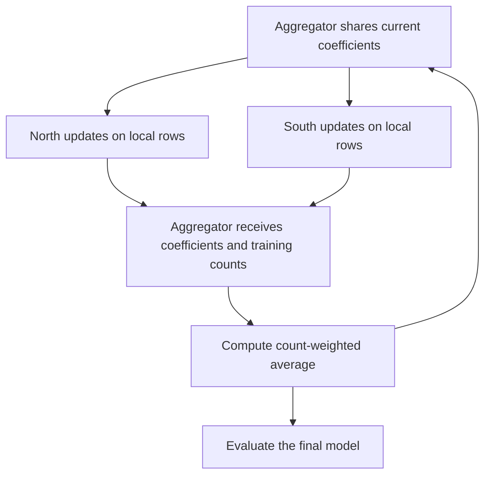

# Federated Chronic Care Benchmark

**A Research prototype comparing clinic-local, pooled, and federated learning for chronic-disease risk prediction using synthetic FHIR R4 records.**

This project studies whether a shared model trained through federated averaging behaves similarly to a model trained on pooled records, and how both models perform at a simulated clinic that contributed no training data. It uses the same type 2 diabetes endpoint and synthetic cohort rules as the companion `cardiometabolic-risk-toolkit` project.

The first release asks:

> Among adults with recorded prediabetes at baseline, how do clinic-local, pooled, and federated training compare when estimating the probability of a first recorded type 2 diabetes diagnosis within the next 365 days?

The endpoint is a **recorded diagnosis**. In a real study, the timing of that record can depend on testing, care access, and documentation as well as progression of the underlying condition.

## Table of contents

- [Project goals](#project-goals)
- [Quick start](#quick-start)
- [Study design](#study-design)
- [How federated training works](#how-federated-training-works)
- [Default benchmark results](#default-benchmark-results)
- [Reading the benchmark report](#reading-the-benchmark-report)
- [Sample use cases](#sample-use-cases)
- [Repository structure](#repository-structure)
- [Testing and reproducibility](#testing-and-reproducibility)
- [Privacy scope and limitations](#privacy-scope-and-limitations)
- [Future research directions](#future-research-directions)

## Project goals

A healthcare organization considering a collaborative risk model needs to know how much it gains from working across sites, what information participants must exchange, and whether the resulting model transfers to a different clinic. This benchmark gives each of those questions a concrete way to be tested on synthetic data.

The project demonstrates how to:

- Construct a longitudinal cohort from simulated FHIR R4 `Patient`, `Condition`, and `Observation` records.
- Compare three training approaches using the same endpoint, baseline features, and evaluation patients.
- Run sample-weighted federated averaging, commonly called **FedAvg**, with two simulated training clinics.
- Evaluate models on later-period patients from the participating clinics and on patients from a third clinic held out of training.
- Compare discrimination, probability error, and calibration at each evaluation clinic.
- Document exactly what is exchanged in the simulated federated training loop and which privacy controls would require additional work.

The companion `cardiometabolic-risk-toolkit` focuses on cohort construction, feature provenance, and baseline validation. This repository reuses its synthetic data generator and cohort rules to study **how the choice of training arrangement affects model performance**. It includes its own fixture code and runs independently.

## Quick start

Use Python **3.11 or 3.12**. Run the commands from the repository folder.

### macOS or Linux

```bash
python -m venv .venv
source .venv/bin/activate
python -m pip install -r requirements.txt
python benchmark.py
```

### Windows PowerShell

```powershell
python -m venv .venv
.\.venv\Scripts\Activate.ps1
python -m pip install -r requirements.txt
python benchmark.py
```

The default benchmark report is written to `build/benchmark.json`. To reproduce the default run in a separate output file:

```bash
python benchmark.py --seed 42 --out build/benchmark-seed-42.json
```

To run the verification tests:

```bash
python -m unittest discover -s tests -v
```

The benchmark generates its inputs locally. It requires no FHIR server, cloud account, or access to clinical records.

## Study design

### Cohort, features, and outcome

| Component | Rule used in this release |
|---|---|
| **Unit of analysis** | One row per eligible synthetic adult |
| **Prediction date** | The index date assigned in the simulated study metadata |
| **Baseline eligibility** | Age 18 or older, recorded prediabetes by the index date, and no recorded type 2 diabetes by that date |
| **Follow-up** | At least 365 days of simulated observation after the index date |
| **Outcome** | First recorded type 2 diabetes diagnosis from day 1 through day 365 after the index date |
| **Core features** | Age at baseline, most recent eligible A1c, and change from the prior eligible A1c on a distinct measurement day |
| **A1c availability** | The result must be final, use UCUM percent, and have been measured and issued by the prediction date. It must fall within the preceding 365 days. |
| **Missing values** | Missing A1c inputs map to zero after fixed transformations. Separate indicators preserve whether each value was missing. |
| **Model family** | Logistic regression with the same fixed feature transformations, starting coefficients, learning rate, and L2 penalty across training approaches |

The fixed feature transformations matter for the comparison. Each clinic can prepare inputs using the same published rules without first sharing local means, standard deviations, or imputation statistics. These reference values are simulation design choices.

### Clinic and time splits

| Population | Simulated clinic | Prediction period | Role |
|---|---|---|---|
| Training | North and South | 2022 | Fit the local, pooled, and federated models |
| Later-period evaluation | North | 2024 | Compare the three models on the same later North patients |
| Later-period evaluation | South | 2024 | Compare the three models on the same later South patients |
| Held-out clinic evaluation | Coastal | 2024 | Compare the pooled and federated models at a clinic excluded from training |

The evaluation patients are distinct from the training patients. Coastal has a higher simulated underlying event probability and more missing historical A1c results. Its evaluation reflects a combined **site shift and time shift**. The design cannot isolate each effect.

### What each training approach uses

| Approach | Training data | How it is evaluated |
|---|---|---|
| **Clinic-local** | Each clinic fits its own model using its 2022 patients | The North model is tested on later North patients. The South model is tested on later South patients. |
| **Pooled** | Fit one model using combined 2022 patient rows from North and South | The shared model is evaluated at North, South, and Coastal. |
| **Federated (FedAvg)** | North and South train locally from shared coefficients. The aggregator combines updated coefficients using the clinic training counts. | The shared federated model is evaluated at North, South, and Coastal. |

Coastal has no clinic-local model because it contributes no training cohort. Its comparison covers the two shared models.

## How federated training works



1. **Initialize the shared model.** Begin with one coefficient vector for the logistic regression model.
2. **Send the same coefficients to both clinics.** Each simulated clinic starts the round from the current shared model.
3. **Run local training.** Each clinic takes five full-batch gradient steps using its own records.
4. **Return the updates.** Each clinic supplies its updated coefficient vector and training cohort size.
5. **Aggregate the coefficients.** A clinic's contribution to the average equals its share of the total training patient count.
6. **Repeat and evaluate.** Run 80 rounds, then score the final shared model on the evaluation cohorts.

The local and pooled models each take 400 full-batch training steps. In FedAvg, each clinic takes five steps per round for 80 rounds. This matches the step count along each training path. It does not match computing cost, communication cost, or training time.

See the [benchmark methods](docs/methods.md) for the full design and the boundaries of the simulation.

## Default benchmark results

The bundled report was generated with seed `42`.

| Evaluation cohort | Patients | Clinic-local AUROC | Pooled AUROC | FedAvg AUROC |
|---|---:|---:|---:|---:|
| North, later period | 426 | 0.648 | 0.645 | 0.645 |
| South, later period | 421 | 0.746 | 0.744 | 0.744 |
| Coastal, held-out clinic | 831 | — | 0.683 | 0.683 |

Values are rounded to three decimals. The clinic-local model had slightly higher AUROC at North and South in this run. The observed differences are descriptive. The benchmark provides no confidence intervals or statistical test of equivalence.

The pooled and FedAvg models had similar AUROC and Brier scores across all three evaluation cohorts. At Coastal, both had a Brier score of approximately **0.184**, compared with about **0.125** at North and **0.116** at South. Brier scores depend on the outcome distribution as well as the predictions, so these cross-clinic differences should be read alongside the event rates and calibration bins.

The two training clinics use the same underlying data-generation assumptions. The result demonstrates how these strategies behave under this simulation design. Substantial differences in real clinic populations, data availability, or documentation practices would require a separate evaluation.

Open the [complete sample benchmark report](docs/sample-benchmark.json) for model-level metrics, event counts, and calibration bins.

## Reading the benchmark report

The report groups predictions by **evaluation clinic**, then by **training approach**. Compare models within the same clinic to hold the evaluation patients fixed.

| Report field | Interpretation |
|---|---|
| `synthetic_only` | Identifies the report as generated from simulated data |
| `seed` | Random seed used to generate the synthetic cohort |
| `training_counts` | Included training patients at each participating clinic |
| `rounds` and `local_steps_per_round` | FedAvg training schedule |
| `learning_rate` and `l2_strength_excluding_intercept` | Common optimization settings |
| `evaluation.<clinic>.split` | Whether the clinic is evaluated in the later-period or held-out-site split |
| `evaluation.<clinic>.models` | Metrics for each model evaluated at that clinic |
| `n` and `events` | Number of evaluated patients and recorded diabetes outcomes |
| `observed_rate` and `mean_score` | Actual event fraction and average predicted probability |
| `auroc` | How well the model ranks patients with the recorded outcome above patients without it |
| `average_precision` | Summary of precision across recall levels. Interpret it in light of the clinic's event rate. |
| `brier` | Mean squared error between predicted probabilities and binary outcomes. Lower is better when comparing models on the same cohort. |
| `calibration_bins` | Populated probability ranges with patient counts, average predicted probabilities, and observed event rates |

If an evaluated group has only one outcome class, the report returns `null` for the discrimination metrics. The comparison requires both outcome classes.

## Sample use cases

### 1. Compare three training strategies on the same patients

**Scenario.** A health analytics team wants to see whether collaboration adds value over training a model at each clinic independently.

1. Run `python benchmark.py` and open `build/benchmark.json`.
2. Navigate to `evaluation.north.models`.
3. Compare `site_local`, `pooled`, and `fedavg` using AUROC, average precision, and Brier score.
4. Repeat the comparison under `evaluation.south.models`.
5. Check whether conclusions change when you look at probability error instead of ranking.

**What you learn.** The report compares three approaches on the same patients within each clinic. An approach can rank patients slightly better and still produce similar or worse probability estimates.

### 2. Examine transfer to a clinic excluded from training

**Scenario.** A validation lead wants to understand how the shared models behave at a clinic that contributed no training data.

1. Open `evaluation.coastal`.
2. Confirm that the split is `held_out_site` and that Coastal is absent from `training_counts`.
3. Compare `pooled` and `fedavg` on event counts, AUROC, and Brier score.
4. For each model, compare `mean_score` with `observed_rate`. A lower `mean_score` indicates average underprediction in that cohort.
5. Inspect the calibration bins to see whether errors concentrate in particular probability ranges.

**What you learn.** Clinic-level evaluation shows whether the model's ranking and probability estimates behave differently in the shifted synthetic population. The coastal result combines site and time differences.

### 3. Determine what information crosses the simulated clinic boundary

**Scenario.** A healthcare data architect wants to understand the inputs required by the federated training loop.

1. Open `benchmark.py` and find `federate()`.
2. Trace how `update()` receives the current weights and the local feature matrix and labels.
3. Inspect the tuple that the aggregator receives from each clinic. It contains updated coefficients and the clinic's training count.
4. Review `aggregate()` to verify that those counts determine the averaging weights.
5. Compare that loop with the pooled arm, which fits directly on combined training rows.

**What you learn.** The project shows the data flow for a federated training algorithm and identifies the information the simulated aggregator receives. Coefficients and cohort counts can themselves disclose information about training data.

### 4. Verify the aggregation math

**Scenario.** A collaborator wants to check that a small clinic and a large clinic contribute according to their training cohort sizes.

1. Run `python -m unittest discover -s tests -v`.
2. Inspect the test that combines two coefficient vectors weighted by counts of three and one.
3. Inspect the test that compares a single federated round with one local step per clinic against a single pooled full-batch step.
4. Review why the single-step equality holds when all sites start from the same coefficients and use the same feature representation and regularization.

**What you learn.** The tests verify the weighting rule and an expected mathematical property of the implementation. That single-step property does not imply that repeated multi-step FedAvg will produce the same coefficients or performance as pooled training.

### 5. Check sensitivity to the synthetic sample

**Scenario.** A researcher wants to know whether the observed pooled and FedAvg results depend on the random seed.

```bash
python benchmark.py --seed 42 --out build/seed-42.json
python benchmark.py --seed 123 --out build/seed-123.json
```

1. Confirm that the seed-42 output matches the checked-in sample in your environment.
2. Compare training counts, evaluation event counts, and event rates across runs.
3. Compare the pooled-versus-FedAvg metric differences within each clinic for each seed.
4. Check whether conclusions about the held-out clinic are sensitive to changes in the simulated patient sample.

**What you learn.** Changing the seed provides a new sample under the same generation rules. Testing different patterns of clinic heterogeneity requires explicit changes to the simulation design.

## Repository structure

| Path | Purpose |
|---|---|
| `benchmark.py` | Feature transformation, logistic regression training, FedAvg, clinic-level evaluation, and report generation |
| `study_fixture.py` | Shared synthetic FHIR generator, cohort extraction, and evaluation helpers adapted from the companion toolkit |
| `requirements.txt` | Pinned Python dependencies |
| `tests/test_benchmark.py` | Checks for aggregation weighting, single-step equivalence, and held-out clinic isolation from training |
| `docs/methods.md` | Detailed study design, model comparison, privacy boundaries, and interpretation |
| `docs/sample-benchmark.json` | Reproducible report from the default seed |
| `docs/github-publishing.md` | Repository description, topics, and release information |

## Testing and reproducibility

The included tests verify that:

- Aggregation weights each clinic's coefficients by its training cohort size.
- One FedAvg round with one local gradient step per clinic matches one pooled full-batch step under the same optimization setup.
- Coastal is excluded from training and is evaluated using only the pooled and federated models.
- Both participating clinics have a clinic-local model in their later-period comparisons.

The default seed is `42`. A second run with the pinned dependencies reproduced the bundled report byte for byte in the development environment.

## Privacy scope and limitations

- **Single-process simulation.** Clinic training, aggregation, and evaluation all run in one Python process. The separation between clinics is simulated.
- **Information exchange.** In the FedAvg loop, the aggregator receives individual clinic coefficients and counts. The pooled arm combines patient rows for comparison. Evaluation also runs centrally on the synthetic records.
- **Privacy controls.** The benchmark provides no secure aggregation, differential privacy, protected network transport, authentication, or formal privacy evaluation.
- **Training-site similarity.** North and South share the same underlying simulation assumptions. This limits what the benchmark can say about highly heterogeneous participants.
- **External validity.** Coastal is a simulated clinic. Real cross-site model performance would require appropriately authorized data from an independent population.
- **Uncertainty.** The report presents point estimates, event counts, and calibration bins. It contains no confidence intervals, statistical equivalence testing, or clinical subgroup analysis.

## Future research directions

- Simulate training clinics with unequal sample sizes, different diagnosis frequencies, and different patterns of missing data. Measure when FedAvg diverges from pooled training and how that affects each participating clinic.
- Study how the number of local training steps and the number of communication rounds affect convergence, probability calibration, and communication cost.
- Develop a federated evaluation workflow that computes validation statistics locally and returns aggregate metrics subject to minimum reporting counts.
- Evaluate secure aggregation or differential privacy as explicit mechanisms and document how each changes information exposure and model utility.
- Assess generalizability with appropriately authorized independent cohorts and a prespecified validation protocol.

**Intended use**  
Research and education. The benchmark uses simulated records and scores. It has no established clinical validity and is unsuitable for patient care or clinical decision-making.
